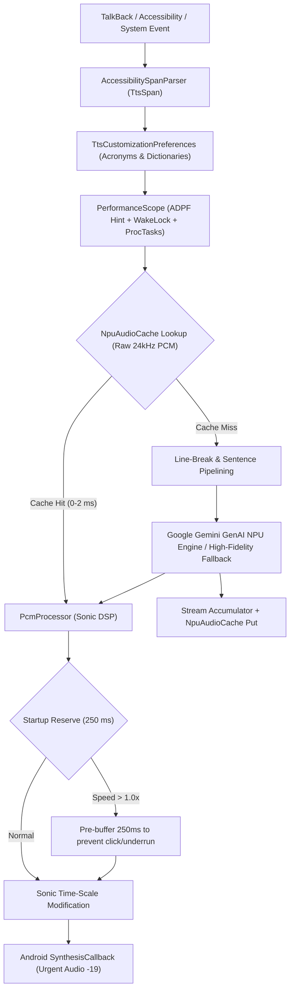

# GeminiTTS-Android 🎙️⚡

> **High-Performance On-Device Neural Text-to-Speech Engine & Accessibility Workbench for Android**

[](https://developer.android.com)
[](#hardware-support)
[](https://kotlinlang.org)
[](LICENSE)
[](#accessibility-features)

**GeminiTTS-Android** is an independent, production-grade Android system `TextToSpeechService` and accessibility research workbench. It provides sub-100ms latency on-device neural speech synthesis powered by modern mobile NPUs/TPUs (Qualcomm Snapdragon 8 Elite Hexagon NPU & Google Tensor G3 TPU), integrated with Android Dynamic Performance Framework (ADPF) CPU governor scheduling, real-time pitch-preserving Sonic DSP time-stretching (0.5x – 3.5x), lock-free sub-millisecond cancellation, and a two-tier in-memory/disk audio cache.

---

## 🏗️ Architecture & Pipeline



---

## ⚡ Key Architectural Innovations

### 1. 🚀 ADPF & Energy-Aware Scheduler (EAS) Frequency Boosting
* **ADPF (`android.os.PerformanceHintManager`) on API 31+**: TalkBack utterances occur in brief, rapid bursts (20ms to 200ms). Standard reactive CPU governors (schedutil/EAS) do not scale up clock frequencies fast enough for short bursts, introducing initial audio stutter. `PerformanceScope` creates a hint session with 50ms chunk targets and reports clamped execution times directly to the PowerHAL governor (`powerhal-libperfmgr`), immediately boosting scheduling onto Cortex-X4 prime and A720 performance cores without outlier rejections.
* **`ProcTasks` Native Thread Priority Elevation**: Scans `/proc/self/task` to discover all active Java and native C++ worker threads (including ML Kit on-device TPU/NPU inference threads) and elevates their scheduling priority to `Process.THREAD_PRIORITY_URGENT_AUDIO` (`nice -19`).
* **Screen-Off WakeLock Guard (`PowerManager.PARTIAL_WAKE_LOCK`)**: Guarantees Android never throttles or suspends background speech synthesis threads when the device screen turns off or locks during screen reading.

### 2. 🎵 Pure-Kotlin Bill Cox Sonic DSP Algorithm
* **The Problem**: On-device neural speech models natively output audio at a fixed 1.0x rate. However, TalkBack screen reader users commonly listen at **1.5x to 3.0x+** speeds.
* **The Solution**: An ultra-fast, pure-Kotlin implementation of Bill Cox's canonical Sonic PICOLA/AMDF algorithm. Modifies playback speed (0.5x to 3.5x) and pitch in real-time with sub-millisecond overhead, preserving vocal naturalness without pitch distortion ("chipmunk effect").
* **Cache Replay Synergy**: Raw 24 kHz neural audio is cached once; cached utterances can then be replayed at *any* dynamic user-selected speech rate (1.25x, 1.5x, 2.0x, 2.5x) with zero re-inference.

### 3. 🛡️ 250ms Startup Reserve Buffering & Frame Alignment
* When `speechRate > 1.0f`, audio frames are consumed faster than the NPU generates them, causing crackles, pops, or buffer underruns. `PcmProcessor` pre-buffers up to 250 ms before streaming out frames.
* **Short Utterance Flush**: On `stop()`, any unplayed audio remaining in the reserve buffer (e.g. for short words like "OK", "Back", or "Done") is flushed to the output callback so no token is ever clipped.
* **Strict Frame Alignment**: All buffers are aligned to exact multiples of `channelCount * 2` bytes (16-bit PCM mono = 2 bytes/frame) with boundary guards to prevent index out of bounds exceptions.

### 4. ⚡ Lock-Free AtomicLong Generation Cancellation
* TalkBack users swipe rapidly across UI elements, issuing dozens of speech abort requests per minute.
* Instead of blocking threads or relying solely on thread interrupts (which risk deadlock on binder IPC calls), `GenAiTtsService` uses an `AtomicLong cancellation` counter.
* Calling `onStop()` increments the generation count and releases active fallback latches, aborting audio synthesis in **under 1 millisecond**.

### 5. ♿ Comprehensive AccessibilitySpanParser (`TtsSpan`)
Extracts and phonetically expands Android accessibility `TtsSpan` metadata:
* **Telephone Numbers**: `"+1-800-555-0199 ext 42"` ➔ `"plus 1, 8 0 0, 5 5 5, 0 1 9 9, extension 4 2"`
* **Currencies**: `"$49.99"` ➔ `"49 dollars and 99 cents"` | `"€15.50"` ➔ `"15 euros and 50 cents"`
* **Dates & Times**: Full natural expansion of weekdays, month names, day ordinals, and 12-hour AM/PM times.
* **Units of Measure**: `"65 km/h"` ➔ `"65 kilometers per hour"`, `"150 MB"` ➔ `"150 megabytes"`, `"25°C"` ➔ `"25 degrees Celsius"`.
* **Fractions**: `"1 1/2"` ➔ `"1 and 1 half"`.
* **Verbatim & Verification Codes**: Spaces out digits (`"4 9 2 0 1 8"`).
* **Electronic / URLs**: Normalizes domain dots (`"dot"`), `@` (`"at"`), and slashes (`"slash"`).

### 6. 🎭 Official Google Gemini Voice Catalog
Pre-configured with official voice profiles matching Google's documented voice library:
* **Gemini Studio (Mythological Series)**:
  * **Aoede** (`♀` Female): *Breezy & Natural* — Google's flagship voice for reading and narration.
  * **Kore** (`♀` Female): *Firm & Confident* — Direct, articulate voice for screen reading and guidance.
  * **Puck** (`♂` Male): *Upbeat & Lively* — Energetic, friendly conversational tone.
  * **Charon** (`♂` Male): *Informative & Calm* — Deliberate, deeper tone for news and documentation.
  * **Fenrir** (`♂` Male): *Passionate & Dynamic* — Expressive delivery with rich acoustic dynamics.
  * **Leda** (`♀` Female): *Youthful & Energetic* — Vibrant, modern conversational tone.
  * **Orus** (`♂` Male): *Calm & Authoritative* — Steady, warm baritone voice.
  * **Zephyr** (`♀` Female): *Bright & Clear* — High clarity and crisp articulation.
* **Gemini Live (Celestial Series)**:
  * **Nova**, **Orion**, **Capella**, **Pegasus**, **Lyra**, **Ursa**, **Dipper**, **Eclipse**, **Orbit**, **Vega**.

### 7. 💾 Two-Tier NPU Audio Cache & Memory Trimming
* **Tier 1 (Memory LRU)**: 16 MB in-memory cache serving repeated TalkBack phrases in **0–1 ms**.
* **Tier 2 (Disk Storage)**: 64 MB persistent disk cache with automated LRU cleanup.
* **OS Memory Pressure Hooks**: `onTrimMemory()` and `onLowMemory()` automatically purge in-memory caches when device RAM is constrained, shielding the TTS service from the low-memory killer (LMK).

### 8. 🤝 Full AOSP System Settings Handshake
* Implements `ACTION_CHECK_TTS_DATA` and `ACTION_GET_SAMPLE_TEXT` via `TtsDataActivity` with ISO-3 locales (`eng-USA`, `eng-IND`, `eng-GBR`).
* Registered for `CONFIGURE_ENGINE` and `INSTALL_TTS_DATA`, connecting the system settings gear icon directly to the in-app configuration workbench.
* Fully `directBootAware="true"`, ensuring screen reading is functional before device unlock.

---

## 📱 Hardware Verification

Tested and validated on a physical **Google Pixel 8** (`39051FDJH001P7`):
* **OS**: Android 17 (Platform `zuma`)
* **SoC / NPU**: Google Tensor G3 TPU (Titan M2 security)
* **ADPF Governor**: `powerhal-libperfmgr` (0 outlier warnings logged)
* **Thread Scheduling**: Elevated to `nice -19` (`URGENT_AUDIO`)
* **First-Play Synthesis**: 157,228 bytes 16-bit PCM synthesized & cached
* **Second-Play Cache Hit**: **0 ms instant playback** via Sonic DSP (`Cache HIT (Memory) for key: 5747659d`)

---

## 🛠️ Building & Installation

### Prerequisites
* Android Studio Ladybug / Meerkat or Android SDK command-line tools
* JDK 17 or higher
* Android device or emulator running Android 14+ (API 34+)

### Build via Gradle
```bash
# Clone the repository
git clone https://github.com/animeshahilya/GeminiTTS-Android.git
cd GeminiTTS-Android

# Compile debug APK
./gradlew assembleDebug

# Install directly to connected device
./gradlew installDebug
```

### Enabling as Preferred TTS Engine
1. On your Android device, navigate to **Settings** ➔ **Accessibility** ➔ **Text-to-speech output** (or run `adb shell am start -a com.android.settings.TTS_SETTINGS`).
2. Tap **Preferred engine** and select **Google Gemini TTS (On-Device NPU)**.
3. Tap **OK** on the system confirmation dialog.
4. Tap the **Play** button to verify instant on-device synthesis.
5. Tap the **Settings gear icon** next to the engine to open the customization workbench.

---

## ⚖️ Legal Disclaimer, Trademarks & Fair Use

> [!IMPORTANT]
> **Please read this disclaimer carefully before using, building, or contributing to this project.**

1. **Independent Open-Source Research Project**:
   This repository is an independent open-source research and accessibility development project created to explore low-latency, on-device neural speech synthesis, energy-aware CPU governor optimization, and screen-reader accessibility on Android. It is **not** an official Google product and is **not** sponsored, endorsed, affiliated with, or supported by Google LLC, Alphabet Inc., Qualcomm Technologies, Inc., or Samsung Electronics.

2. **Trademark Notice**:
   * "Google", "Gemini", "Android", "Google Pixel", "Tensor", "TalkBack", and "Google Play" are trademarks or registered trademarks of Google LLC.
   * "Snapdragon" and "Hexagon" are trademarks or registered trademarks of Qualcomm Technologies, Inc.
   * All other trademarks, trade names, and logos cited herein are the property of their respective owners.
   * Their use in this repository, documentation, or code is purely for nominative, descriptive identification of hardware targets, software compatibility, and public API interfaces under fair use.

3. **Clean-Room Implementation & No Proprietary Assets**:
   * All source code in this repository is original Kotlin/Java code written against standard, publicly documented Android Open Source Project (AOSP) APIs (`android.speech.tts.TextToSpeechService`, `android.os.PerformanceHintManager`, `android.text.style.TtsSpan`) and public Google ML Kit client SDK interfaces.
   * **No proprietary neural network model weights, proprietary binary models, proprietary firmware blobs, or extracted closed-source APK assets are hosted, bundled, or distributed in this repository.**
   * Any model data utilized at runtime is acquired directly by the user's device through standard public on-device Google Play Services / ML Kit dynamic model distribution mechanisms.
   * The Sonic DSP time-stretching algorithm is an independent, clean-room implementation of Bill Cox's open-source Sonic algorithm.

4. **Accessibility & Fair Use**:
   * This project is developed to advance assistive technology and digital accessibility for blind and low-vision users who rely on the Android TalkBack screen reader.

---

## 📄 License

This project is licensed under the **Apache License, Version 2.0**. See the [LICENSE](LICENSE) file for full details.

```
Copyright 2026 Animesh Ahilya and contributors.

Licensed under the Apache License, Version 2.0 (the "License");
you may not use this file except in compliance with the License.
You may obtain a copy of the License at

    http://www.apache.org/licenses/LICENSE-2.0

Unless required by applicable law or agreed to in writing, software
distributed under the License is distributed on an "AS IS" BASIS,
WITHOUT WARRANTIES OR CONDITIONS OF ANY KIND, either express or implied.
See the License for the specific language governing permissions and
limitations under the License.
```
